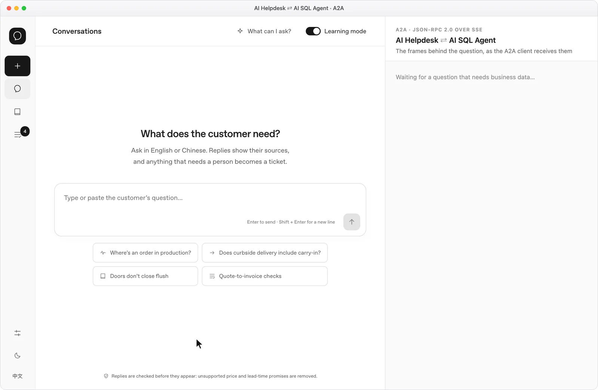

<div align="center">

# A2A Contract

**一份带版本、由机器校验的契约，约束客服 Agent 与数据 Agent 之间的协作。**

它规定 AI Helpdesk 怎样通过 A2A 把数据问题委派给 AI SQL Agent、每个阶段怎样经 SSE 流回来，以及结果满足什么条件才能用来回答：一份协议文档、五个 JSON Schema、30 个 golden fixture 和一个自检脚本，两个 Agent 的 CI 都按 tag 钉住它。

[](a2a-streaming-contract.md)
[](docs/a2a-integration.md)
[](schema/)
[](tools/check_contract.py)
[](https://github.com/heyemlee/a2a-contract/actions/workflows/contract.yml)

[English](README.md) · **简体中文**

[技术亮点](#技术亮点) · [系统架构](#系统架构) · [技术栈](#技术栈) · [功能](#功能) · [接入](#接入)

</div>

<p align="center">
  
</p>

<p align="center"><sub>虚构的订单，接口是模拟的。右侧的帧按同一份模拟数据回放，都能通过本仓库的 schema 校验。</sub></p>

## 技术亮点

- **一份载荷，三种传输。** `message/stream`（JSON-RPC 2.0 over SSE）、`message/send` 和直连 `POST /query` 传的是同一个 data part：7 个必填字段、同一套信任规则，所以回退或回滚都不会改变什么算证据。
- **送达不等于成功。** `completed` 只说明载荷送到了；`execution_status`（5 个取值）说明查询跑成了没有，风险、降级或截断仍可能让结果不能用。字段缺失或类型不对一律按不可信处理：字符串 `"false"` 不是布尔值。
- **交给机器检查。** 5 个 JSON Schema（Draft 2020-12）和 30 个 golden fixture，分 6 组，其中 7 个能通过 schema，但不是可以直接采信的证据。`tools/check_contract.py` 确认每个反例真的被拒、每个链接和 `§` 引用都存在、版本号在 5 处一致；每次推送 `main`、提 PR 和打 tag，GitHub Actions 都会跑它。
- **超时按实测定。** 82 次审计过的模型调用里，查库平均 17.7 秒，最慢一次 68.3 秒，所以客户端静默 20 秒或总长 90 秒就放弃，进度事件就是心跳。被取消的运行在下一个检查点停下：6 次实测取消用时 0.07–2.7 秒。
- **像对外 API 一样发版。** 两个 Agent 的 CI 都钉 `v1.13`，拉不到契约就失败而不是跳过。发布过的 tag 不改契约内容：`v1.11` 存在的唯一理由，就是修正 `v1.10` 里带错的版本号。

## 系统架构

<p align="center">
  
</p>

[AI Helpdesk](https://github.com/heyemlee/ai-helpdesk) 负责对话与编排，[AI SQL Agent](https://github.com/heyemlee/ai-sql-agent) 负责查询业务数据，本仓库定义两者之间的接口，本身不部署任何服务。遇到订单类问题，客服读取 Agent Card 并打开 `message/stream`；SQL Agent 的循环一边调用模型、执行只读 SQL，一边每个阶段流回一条 status-update，最后是一个 artifact 和一个终态事件，客服先判断 data part，专家才能使用。知识类问题不会离开客服。蓝色表示请求和数据，青绿色表示协议事件，橙色表示模型调用，紫色表示契约。

- **不发保活帧。** 客户端 20 秒收不到事件就断开，服务端发出的每个事件都是真实的阶段切换，所以卡住的查询 20 秒就会判死，不会被保活帧一直续到 90 秒上限。
- **只在开流之前回退。** 开流之前收到 `-32004` 时还没有任何开销，客户端可以改发 `message/send`；开流之后任何失败都直接结束这次调用，因为重发会让同一个查询跑两遍、扣两份配额。

## 技术栈

| 层 | 技术 | 作用 |
| --- | --- | --- |
| 协议 | A2A 0.2 子集 · JSON-RPC 2.0 · Server-Sent Events | `POST /a2a` 上的 `message/stream` 和 `message/send`；`task`、`status-update`、`artifact-update` 三类事件 |
| 发现 | Agent Card | 位于 `/.well-known/agent.json`；`capabilities.streaming` 决定走 stream 还是 send；客户端缓存 30 秒 |
| 契约面 | JSON Schema Draft 2020-12 | data part、进度事件、终态事件、stage 名称、`*_db` 标识符格式 |
| 共享样本 | Golden fixtures · `fixtures/index.json` | 30 份载荷，每份写明期望的 schema 结果、信任判定和用途 |
| 自检 | Python 3.12 · jsonschema · referencing | schema、fixtures、链接与 `§` 引用、版本号一致性 |
| CI | GitHub Actions | 本仓库跑自检；两个 Agent 在各自的 CI 里按钉住的 tag 跑 fixtures |
| A2A 客户端 | AI Helpdesk · FastAPI · httpx | 发起流式调用，执行 20 秒和 90 秒两道限制，三种传输共用一个 `assess()` |
| A2A 服务端 | AI SQL Agent · FastAPI | 发出各阶段事件、data part 和一个终态事件；调用方断开时取消运行 |

## 功能

### 流式协议

- **顺序有保证。** 一个 `task`、若干 `status-update`、一个 `artifact-update`，最后恰好一个终态事件：`completed`、`failed` 或 `canceled`。
- **stage 名称就是契约。** 9 个 stage 名称固定，与服务端内部怎么命名无关。`repair` 每个 step 至多一次，step 只增不减，所以同一个 step 出现第二个 `repair` 就是服务端的 bug，客户端能识别出来。
- **错误发生在开流之前。** 密钥无效返回 JSON `-32600`，限流和配额返回 429、`Retry-After` 和 `-32029`，流式关闭返回 `-32004`，都在任何事件之前。同一个 `trace_id` 出现在响应头和每个事件里。

| 实测 | 结果 |
| --- | --- |
| 查库请求，82 次审计过的模型调用中的 7 次 | 平均 17.7 秒 |
| 全部 82 次 | p50 6.6 秒 · p90 17.7 秒 · max 68.3 秒 |
| 一次端到端运行中，服务端相邻两个事件的最长间隔 | 9.5 秒，低于 20 秒静默阈值 |
| 从取消到停下，真实模型上 6 次 | 0.07–2.7 秒 |

数据记录在契约里（§2、§5.4 和状态行下方的记录）。完整的交互也画成了[时序图](docs/diagrams/a2a-sequence.zh-CN.svg)，另有[可交互版本](docs/diagrams/a2a-sequence.zh-CN.html)。

### 结果信任

- **五种结局。** `execution_status` 取 `success`、`partial_success`、`no_data`、`failed` 或 `not_applicable`：“查到了，答案是没有”和“没查成”要给出不同的回答。
- **什么能支撑回答。** 终态是 `completed`，状态是 `success` 或 `partial_success`，且 `has_risk` 和 `degraded` 都为 false。部分成功只能支撑成功步骤的内容；被截断的结果不能用来声称总数或计数。
- **缺失即不可信。** 缺少 `has_risk` 或 `degraded` 按 true 处理，缺少 `queried_database` 按 false 处理；没有 `as_of` 就不说日期。

### 共享用例与消费者测试

| 组 | 防的是什么 | 用例数 |
| --- | --- | ---: |
| A | 合法的 data part，三种传输取出来逐字相同 | 3 |
| B | 必须被 schema 拒绝：缺信任字段、字符串 `"false"`、自相矛盾 | 6 |
| C | 能通过 schema 但不是可直接采信的证据：失败、部分成功、有风险、降级重放、截断、无数据 | 6 |
| D | 数据库标识符：清单外但格式合法的照常采信，格式错误的被拒 | 2 |
| E | 进度事件信封 | 8 |
| F | 终态事件；顺序类断言要用整条流验证 | 5 |

- 每个 fixture 就是载荷本身；`fixtures/index.json` 记录它期望的 schema 结果、信任判定和存在的理由。
- 两个 Agent 都按钉住的 tag 读同一批文件，不复制进自己的仓库，因为副本会漂移。
- A 组和 B 组必须同时通过：什么都拒绝的实现能过 B 组，但过不了 A 组。两侧各自断言什么，见 [CONSUMER-TESTS.md](CONSUMER-TESTS.md)。

### 边界

- **A2A 0.2 的子集。** Agent Card 写的是 `0.2`。A2A 1.0 去掉了这套事件赖以区分类型的 `kind` 字段，所以升级是一次大版本契约变更，不是改个版本号。
- **永远不做答案增量。** 委派回来的文本只有经过客服自己的模型和逐句守卫才会到达用户；直接流式转发会绕过守卫。
- **共享的服务身份。** 用户会话在下游是隔离的，但一次查询能看到哪些数据，由 SQL Agent 的服务密钥决定，而不是最终用户（[身份接入说明](https://github.com/heyemlee/ai-helpdesk/blob/main/docs/integrations/sql-agent-identity-requirements.md)）。

## 接入

```bash
git clone --depth 1 --branch v1.13 https://github.com/heyemlee/a2a-contract.git .contract  # 钉 tag，不跟 main
export A2A_CONTRACT_DIR="$PWD/.contract"  # 两个 Agent 的契约测试首先在这里找
export A2A_CONTRACT_REQUIRED=1            # 找不到契约时失败，而不是跳过
```

要让两个 Agent 改走 A2A，在 AI Helpdesk 里设置 `SQL_AGENT_TRANSPORT=a2a`（默认是 `POST /query`）和 `SQL_AGENT_TIMEOUT_S=90`，SQL Agent 要求密钥时再配上 `SQL_AGENT_API_KEY`；AI SQL Agent 默认开启流式。超时预算和回退方式见 [docs/a2a-integration.md](docs/a2a-integration.md)。

## 测试

```bash
python3 -m venv .venv && .venv/bin/pip install jsonschema referencing  # 自检只依赖这两个包
.venv/bin/python tools/check_contract.py           # schema、fixtures、链接、版本号，和 CI 跑的一样
.venv/bin/python tools/check_contract.py fixtures  # 只跑一段：schema、fixtures、links 或 version
```

## 发布

```bash
.venv/bin/python tools/check_contract.py version  # 每一处写着版本号的地方都必须一致
git tag vX.Y && git push origin vX.Y              # 最后一步：发布过的 tag 不改契约内容
```

契约变更是双边事件：两个 Agent 都要改 pin（AI SQL Agent 两处，AI Helpdesk 三处）并接入新增的用例。流程和完整历史见 [docs/maintenance.md](docs/maintenance.md#版本)。

| tag | 变更 |
| --- | --- |
| `v1.13` | 调用方断开后，运行在下一个检查点取消；新增传输终态 `canceled`，带 schema 和 5 个用例；429 改用 `-32029` |
| `v1.12` | `execution_status` 改为必填；缺这个字段的 `dp-trust-01` 改判到 B 组 |
| `v1.11` | 契约与 `v1.10` 相同，只修正了版本号；请钉这一版而不是 `v1.10` |
